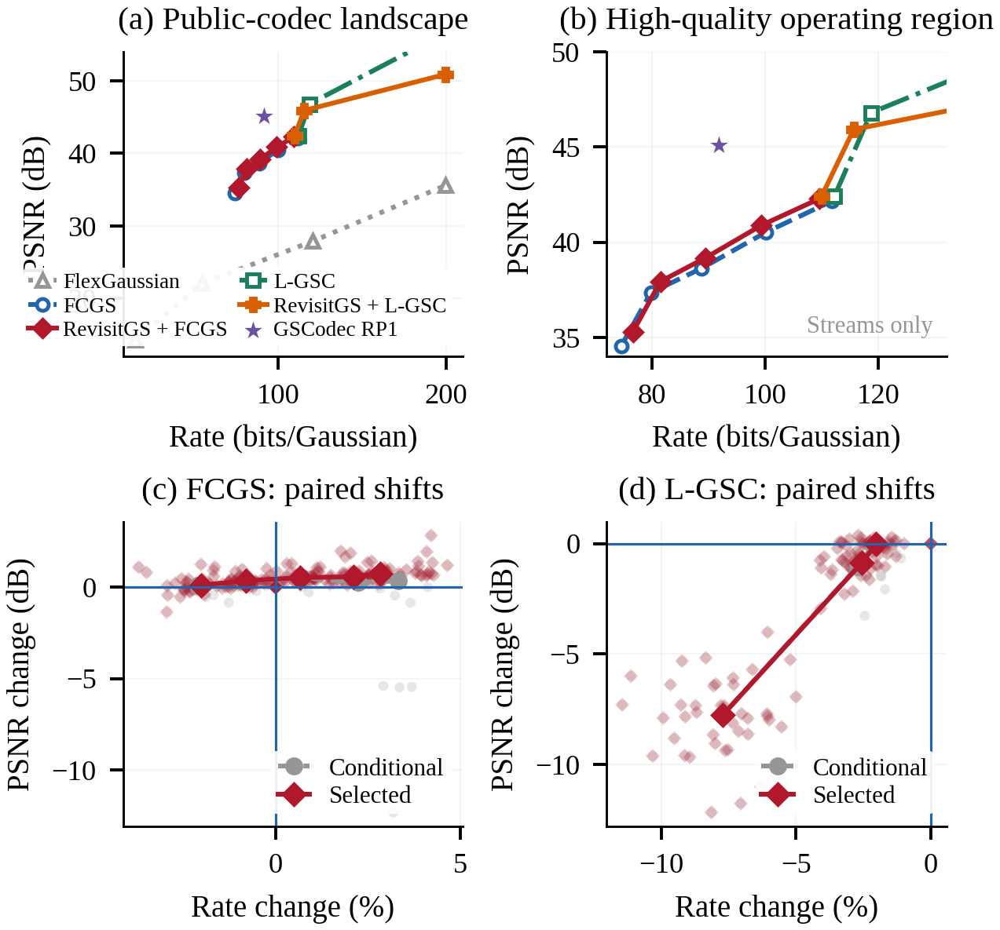
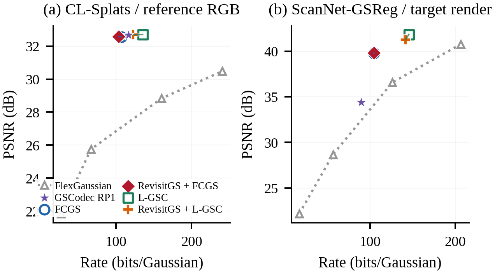
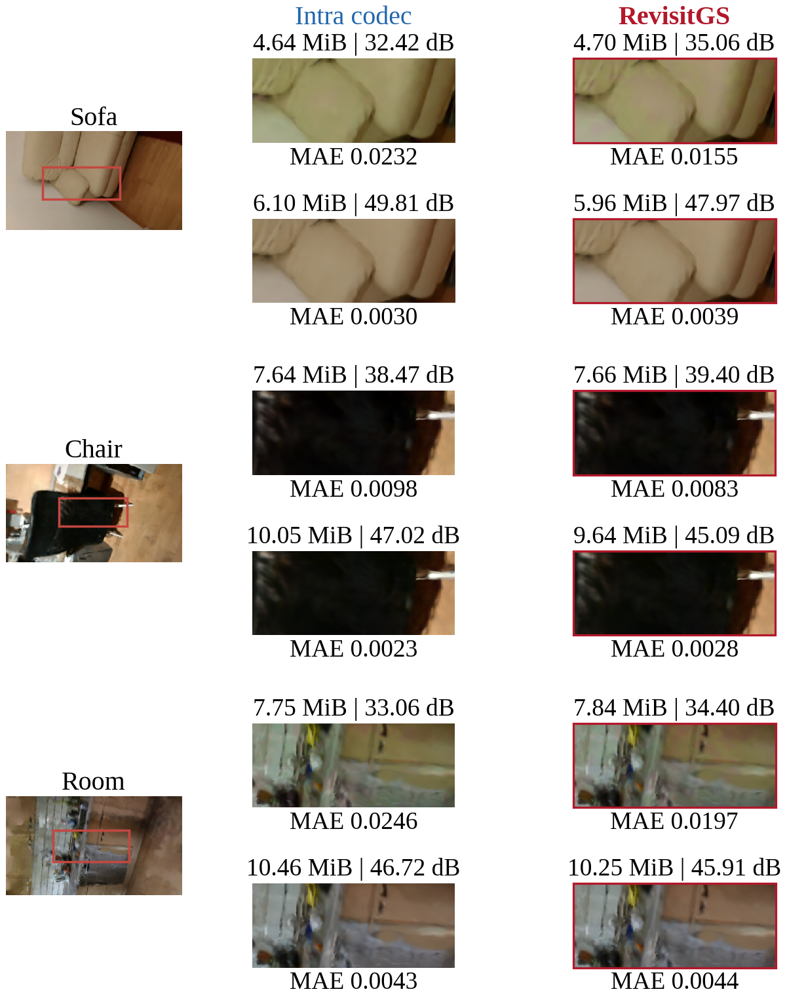

# RevisitGS

Reference-conditioned coding of independently reconstructed 3D Gaussian scenes. This repository provides the final codec, per-pair measurements, and the data and scripts for reproducing the paper tables and experimental figures.

RevisitGS conditionally codes an aligned revisit 3D Gaussian map from a stored map. The encoder builds collision-free local transport, assigns economical predictions to a revision stream, and sends the remaining target primitives to a public intra codec. The decoder reconstructs a conventional, complete 3DGS map from the stored map, the revision stream, and the decoded birth map.

## Results preview







The remaining experimental figures are available in [results/visualizations](results/visualizations). The JSON records retain per-pair measurements, including unfavorable outcomes and intra fallbacks.

### Quick CPU verification

The released measurements and all experimental figure assets can be checked
without datasets, CUDA, or third-party codecs:

```bash
pip install -r requirements-lock.txt
python scripts/check_codec.py
python scripts/audit_results.py --output runs/metric_audit.json
python scripts/reproduce_results.py --output runs/reproduced
```

The audit recomputes mode choices, BD metrics, matched-rate comparisons,
confidence intervals, representation ablations, independent-view summaries,
and the released FlexGaussian and GSCodec cohort means.

## 1. Environment and dependencies

The experiments used Python 3.10, PyTorch with CUDA support, and a C compiler. Create an isolated environment, install the PyTorch build matching the local CUDA toolkit from the official PyTorch instructions, and then install the lightweight RevisitGS dependencies:

```bash
conda create -n revisitgs python=3.10 -y
conda activate revisitgs
pip install -r requirements-lock.txt
```

The lock file records the tested lightweight dependency versions; `requirements.txt`
provides compatible lower bounds. Recalculating saved results and running the codec
checks do not require PyTorch or a GPU. From the repository root, run
`python scripts/check_codec.py` for a quick verification, including empty birth-map
PLY files. Use Linux with a `cc` compiler for the native transport routine.

Clone the two public intra codecs only when reproducing the corresponding end-to-end streams:

```bash
git clone https://github.com/YihangChen-ee/FCGS.git third_party/FCGS
git -C third_party/FCGS checkout 31e59a46f7e51505b46a7bbe6e53268ee3155fbf
git -C third_party/FCGS submodule update --init --recursive
git clone https://github.com/qualcomm/lite-3Dgsplat-codec.git third_party/L-GSC
git -C third_party/L-GSC checkout a78ee6edeb17712d2b81936db41b9fd2bfac5b88
```

Build FCGS and L-GSC according to their official instructions. FCGS additionally requires the `tmc3` executable supplied by its MPEG G-PCC dependency. The coding algorithms are unchanged. On the tested PyTorch build, the three FCGS CUDA-extension setup files use C++17 instead of C++14; apply `python scripts/prepare_public_codecs.py --fcgs third_party/FCGS` before installing those extensions. The tested commits above and the SHA-256 hashes of the five FCGS operating-point checkpoints are recorded in `configs/codec_versions.json`.

## 2. Input convention

Both inputs are standard INRIA 3DGS PLY files with centers, SH coefficients, opacity logits, log-scales, and `wxyz` quaternions. The target must already be expressed in the stored-map coordinate frame; registration is an encoder-side common input and is not part of the transmitted payload. `scripts/canonicalize_target.py` applies a supplied Sim(3), including the required directional SH rotation, through the public [splatreg](https://github.com/Archerkattri/splatreg) implementation at commit `c8f1c6de1680204ff15392f519947efab2426155`. If the inputs are already aligned, this optional dependency is unnecessary.

The example below encodes the final paper configuration: radius `0.01` of the robust joint extent, eight candidate neighbors, collision-resolved transport, 50% residual-complexity allocation, and rank-four directional SH revisions.

```bash
python scripts/encode_pair.py \
  --source /path/to/stored_map.ply \
  --target /path/to/aligned_revisit.ply \
  --output runs/example
```

The command writes:

- `revision.bin`: independently decodable RevisitGS revision payload;
- `birth_input.ply`: self-contained birth subset for a public intra codec;
- `target_canonical.ply`: filtered, finite-precision canonical target used by the experiment;
- `metadata.json`: counts, stream size, and allocation statistics.

## 3. Public birth-stream codecs

FCGS example:

```bash
cd third_party/FCGS
python encode_single_scene.py --lmd 0.0004 --determ 1 \
  --ply_path_from ../../runs/example/birth_input.ply \
  --bit_path_to ../../runs/example/fcgs_birth
python decode_single_scene.py --lmd 0.0004 \
  --bit_path_from ../../runs/example/fcgs_birth \
  --ply_path_to ../../runs/example/birth_decoded.ply
cd ../..
```

L-GSC example (level 1):

```bash
third_party/L-GSC/build/source/lgsc-api-example1 --mode 0 \
  --uncompressedDataPath runs/example/birth_input.ply \
  --compressedStreamPath runs/example/birth.lgsc --compLevel 1
third_party/L-GSC/build/source/lgsc-api-example1 --mode 1 \
  --compressedStreamPath runs/example/birth.lgsc \
  --reconstructedDataPath runs/example/birth_decoded.ply --outputBinaryPly true
```

Use `compLevel` 0, 1, and 2 for the three native operating points. To construct the public intra reference, encode `target_canonical.ply` with the same codec setting instead of `birth_input.ply`, then decode and evaluate it with the same cameras.

Decode the complete conditional scene:

```bash
python scripts/decode_pair.py \
  --source /path/to/stored_map.ply \
  --revision runs/example/revision.bin \
  --birth runs/example/birth_decoded.ply \
  --output runs/example/reconstructed.ply
```

The total conditional rate is the byte size of `revision.bin`, the public birth bitstream, and one byte for the transmitted global mode. Full intra coding is retained when its measured objective is lower. The unchanged development-calibrated distortion is `10**(-mean_view_PSNR/10)`, the geometric mean of viewwise MSE, **not** arithmetic image MSE. `scripts/select_mode.py` compares actual streams and writes the one-byte mode/profile signal:

```bash
python scripts/select_mode.py --conditional runs/example/conditional.json \
  --intra runs/example/intra.json --target-gaussians N \
  --mode-output runs/example/mode.bin --output runs/example/selection.json
```

The two input JSON files must contain the total serialized rate including the one mode byte, and the same selection-view set. The selector rejects nonfinite PSNR, invalid byte counts, inconsistent target populations, and mismatched view identifiers when provided by the evaluation records. Evaluation rejects missing or empty payload paths instead of counting them as zero bytes. Profile ID 0 denotes FCGS at the agreed operating setting; other settings/backend IDs must be agreed by both endpoints. The chosen public codec decodes its intra or birth payload; conditional mode additionally uses `decode_pair.py`. With zero reusable candidates the encoder recommends full intra and retains the complete target as birth input.

Render a decoded output against its canonical target with the standard 3DGS rasterizer:

```bash
python scripts/evaluate_scene.py \
  --target runs/example/target_canonical.ply \
  --decoded runs/example/reconstructed.ply \
  --cameras /path/to/cameras.json \
  --transform /path/to/rescan_to_reference.json \
  --bitstream runs/example/revision.bin \
  --birth-bitstream runs/example/fcgs_birth/0.0004 \
  --output runs/example/evaluation.json
```

This step requires CUDA PyTorch and the standard `diff-gaussian-rasterization`
CUDA extension. Install the tested renderer in the same environment:

```bash
git clone https://github.com/graphdeco-inria/diff-gaussian-rasterization.git third_party/diff-gaussian-rasterization
git -C third_party/diff-gaussian-rasterization checkout 9c5c2028f6fbee2be239bc4c9421ff894fe4fbe0
git -C third_party/diff-gaussian-rasterization submodule update --init --recursive
pip install --no-build-isolation third_party/diff-gaussian-rasterization
```

 Pass `--views 0` for every available evaluation view. Original multi-rate results use four prescribed views per map; the independent-view validation excludes those views and uses up to 24 further cameras per test pair. Neither this check nor its results modifies the selection rule. Full intra evaluation omits `--birth-bitstream`. Total rates include one mode/profile byte in both cases.

## 4. Reproduce paper tables and figures

Saved measurements can be checked and plotted on CPU without datasets, public codecs, or PyTorch. Install `requirements.txt`, then run:

```bash
python scripts/audit_results.py --output runs/metric_audit.json
python scripts/reproduce_results.py --output runs/reproduced
```

This command first recomputes actual-stream mode choices, pairwise BD integration, matched-rate interpolation, means, positive counts, reuse confidence intervals, and the released recent-codec cohort means from per-pair measurements. It checks these values against the released summaries before generating `summary.md` and all released experimental figure assets. These are recalculations and redraws from saved measurements, not new codec runs. Runtime and other measurements are reported from the saved records; they are not retimed by this command. It does not silently rerun training: RevisitGS requires no neural-network training, and both intra codecs use their public implementations. The directional basis is fitted per pair.

## 5. Complete-cohort execution

Create a pair list following `configs/pairs.example.json`, replacing the source and aligned-target paths with your local Gaussian maps. `configs/evaluation_pairs.json` records the scene identifiers, transforms, and development/test split used for 3RScan. The raw captures do not include our independently optimized Gaussian maps; those maps must be reconstructed before rerunning coding. Run:

```bash
python scripts/run_cohort.py \
  --pairs /path/to/pairs.json \
  --output runs/cohort
```

The script generates RevisitGS inputs for every pair. Public codec encoding, rendering, and metric evaluation then follow the commands above so that the official codec environments remain unchanged. Multi-rate FCGS uses `0.0001, 0.0002, 0.0004, 0.0008, 0.0016`; L-GSC uses its three native levels.

## Reproducibility notes

- The final method has no trained neural network. Its directional residual basis is fitted to each pair by randomized PCA; the transmitted basis is included in rate accounting.
- Stable sorting makes transport deterministic. PCA uses seed 2026.
- Reported rates include the revision header and payload, directional basis, public birth payload, and the mode signal.
- The stored reference and encoder-side alignment are common inputs and are not counted in the revisit payload.

## Validation and interpretation

Run `python scripts/check_codec.py` for predictor ordering, empty/singleton revisions, PLY round trips, and validation of the mode-selection inputs. Predictor rows follow source-index order. The four-bit codes and relative rotations follow the evaluated numerical path. A real-pair equivalence check matched the evaluated revision-core size and decoded geometric attributes, with SH differences below 7e-8. Exact compressed bytes may differ because numerical libraries affect floating-point PCA details.

`results/multirate_rd.json` contains measured-stream selections. FCGS shows a multi-rate improvement; L-GSC does not show an improvement across its entire rate range with the transferred fixed selector. No state-of-the-art predictive-codec reproduction is claimed for controlled reuse variants.

`results/recent_public_codecs.json` records the complete 3RScan evaluation with the official FlexGaussian and GSCodec implementations. `results/recent_external_codecs.json` contains the corresponding CL-Splats and ScanNet-GSReg measurements. FlexGaussian rates measure its serialized quantized model payload; GSCodec and the RevisitGS backbones report coded streams. These records regenerate the public-codec panels without bundling third-party repositories, checkpoints, decoded PLY files, or temporary video-codec data.

Independent-view records for both public backbones are in `results/independent_views.json` (FCGS) and `results/independent_views_lgsc.json` (L-GSC level 1). To rerender these views, evaluate each decoded mode using `--views 24 --exclude-uniform-views 4`, then retain the mode chosen from the original four-view evaluation; do not reselect from the new results. Camera indices are recorded for every pair. The independent-view mean gain is a same-backend-setting comparison, not a matched-rate estimate.

Current figure previews are in `results/visualizations/`. `results/figure_data/` contains the original rendered context images, comparison crops, and projected assignment data needed to redraw the spatial figures. These are real decoded-scene renders, not generated illustrations. Only the portions read by the plotting scripts are retained. Labels report same-view PSNR at the displayed codec setting.

## Representation and reuse ablations

The default encoder remains unchanged. To rerun a fixed representation ablation, use `encode_pair.py --revision-profile PROFILE` with the same source and aligned target. Profiles are `without_directional_revision`, `rank4_q8`, `uniform_q8`, `nested_rank2_q4`, `without_scale_revision`, `without_opacity_revision`, and `without_rotation_revision`. The default is `default_rank4_q4`. The nested-rank profile fits the same rank-four basis and retains its first two components; it does not refit a different PCA basis. Omitted groups inherit the predictor attributes. All profiles share the default transport and birth population, so the same encoded birth stream must be reused. Compare rendered outputs using `evaluate_scene.py` and include the changed revision size and the unchanged birth bytes.

Controlled transport/allocation comparisons use `--candidate-neighbors 1` for collision-resolved nearest transport, `--allocation-score geometry` for geometric allocation, and `--transport-fraction 1.0` for no allocation. These comparisons change the birth population and therefore require re-encoding the birth stream. They are controlled variants of RevisitGS, not additional public methods.

The complete test-cohort representation records are in `results/representation_ablation.json`. They retain every per-pair measurement and the common-birth protocol. `audit_results.py` also verifies these aggregates when the file is present.

## Reproduction scope

The repository includes the RevisitGS implementation, C transport source, evaluation
configuration, numerical records, and real rendered crops needed to redraw all
ten experimental figures. RevisitGS has no learned weights to download.
Recalculating saved results does not rerun compression or rendering. Fresh
end-to-end runs require independently reconstructed Gaussian maps, camera JSON
files, the chosen public codec, and its dependencies; FCGS checkpoints and `tmc3`
are obtained through its official installation instructions. These third-party
assets and the original datasets are not bundled. `run_cohort.py` prepares revision
and birth streams; it does not automate the external codec and rendering commands.

## License

RevisitGS is released under the MIT License. See [LICENSE](LICENSE).
